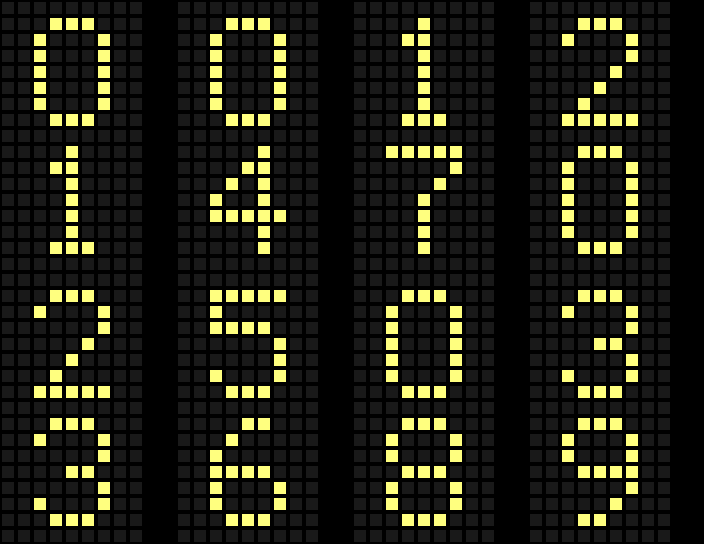

# led-clock

A clock for the two LED matrix input modules on the Framework Laptop 16.

- **Left matrix:** the time in 24-hour format, hours stacked above minutes.
- **Right matrix:** fills up over each minute, LED by LED from the bottom,
  each LED fading in. Every LED is fully lit by the end of the minute.
- **On the minute:** the seconds display rolls down to empty, while each
  clock digit that changed scrambles into random noise and resolves into its
  new value.



It runs until it receives SIGINT, SIGTERM or SIGHUP, then blanks both
displays and exits. Between refreshes it sleeps (every 50ms normally, 16ms
during the minute-change animation), and frames that haven't changed aren't
resent, so it uses well under 1% CPU.

## Building

Requires Go 1.27 or later (see `go.mod`).

```
make
```

## Running

```
./led-clock [flags]
```

| Flag | Default | Description |
|---|---|---|
| `-left` | auto | Serial device of the left matrix |
| `-right` | auto | Serial device of the right matrix |
| `-brightness` | `0` | LED brightness 1-255; 0 leaves it unchanged. The daytime brightness when dimming is on |
| `-night-brightness` | `0` | LED brightness 1-255 at night; 0 disables dimming. Requires `-brightness` |
| `-dawn` | `07:00` | Time of day to start brightening to `-brightness` |
| `-dusk` | `21:00` | Time of day to start dimming to `-night-brightness` |
| `-transition` | `1h` | How long brightening and dimming take |
| `-fade` | `1s` | How long each seconds LED takes to fade in |
| `-roll` | `1s` | Length of the minute-change animations; 0 disables them |
| `-interval` | `50ms` | Sleep between refreshes |
| `-roll-interval` | `16ms` | Sleep between refreshes during the minute-change animation |

Without `-left` and `-right`, the matrices are found by USB ID (`32ac:0020`)
and sorted by device path; the second becomes the left matrix and the first
the right. If they come out on the wrong sides, pass both paths explicitly,
e.g. `-left /dev/ttyACM0 -right /dev/ttyACM1`.

### Dimming at night

With `-night-brightness`, the brightness follows the local time of day: it
starts ramping from `-brightness` down to `-night-brightness` at `-dusk`,
and back up at `-dawn`, each ramp taking `-transition`. For example,
`-brightness 120 -night-brightness 15 -dusk 22:00 -dawn 06:30` is fully dim
from 23:00 and fully bright from 07:30.

### Permissions

The matrices appear as `/dev/ttyACM*`, owned by the `dialout` group. Either
add yourself to `dialout`, or install Framework's udev rule
([`50-framework-inputmodule.rules`](https://github.com/FrameworkComputer/inputmodule-rs))
to give the logged-in user access.

## Running as a service

`led-clock.service` runs the clock at boot as an unprivileged, sandboxed
user in the `dialout` group, restarting it if it exits (for example when
the matrices aren't ready yet).

```
make
sudo make install-service
```

This installs the binary to `/usr/local/bin` (change with `PREFIX=` or
`BINDIR=`) and the unit to `/etc/systemd/system`, then enables and starts
it. Edit the `ExecStart` line in `led-clock.service` to change the flags.

```
journalctl -u led-clock -f    # logs
sudo make uninstall           # stop, disable and remove
```

Stop any manually started `led-clock` first; only one process can drive the
matrices at a time.

## Make targets

| Target | Description |
|---|---|
| `build` (default) | Build `led-clock` |
| `run` | Build and run in the foreground |
| `test`, `vet`, `fmt` | Go checks and formatting |
| `preview` | Render the clock digits to `docs/preview.png` |
| `install` | Install the binary |
| `install-service` | Install the binary and unit, enable and start the service |
| `uninstall` | Remove the service and binary |
| `clean` | Remove build outputs |

## Code

| File | Contents |
|---|---|
| `main.go` | Flags, device setup, refresh loop, signal handling |
| `ledmatrix.go` | Serial protocol and device discovery |
| `schedule.go` | Time-of-day brightness schedule |
| `render.go` | Clock font and layout, seconds fill, minute-change animations |
| `schedule_test.go` | Tests for the brightness schedule |
| `preview_test.go` | Renders digits to a PNG for `make preview` |

### Changing the digits

The 5x7 digits are drawn as text in `render.go`, `#` for a lit pixel and
`.` for an unlit one. Run `make preview` to regenerate `docs/preview.png`
and see the result without the hardware.

### Protocol

Commands are written to the module's USB serial port as two magic bytes
`0x32 0xAC`, a command ID, then parameters. This program uses:

| ID | Command | Parameters |
|---|---|---|
| `0x00` | Brightness | 1 byte |
| `0x07` | StageCol | column index, then 34 greyscale bytes (top to bottom) |
| `0x08` | FlushCols | none; shows all staged columns at once |

See `commands.md` in
[inputmodule-rs](https://github.com/FrameworkComputer/inputmodule-rs) for the
full command set.

## License

Public domain; see [LICENSE](LICENSE).
